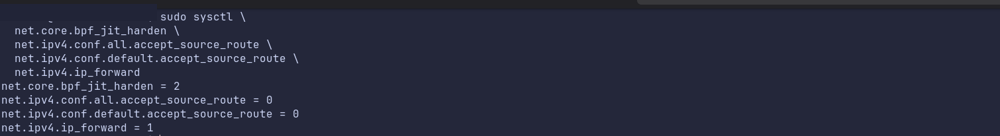
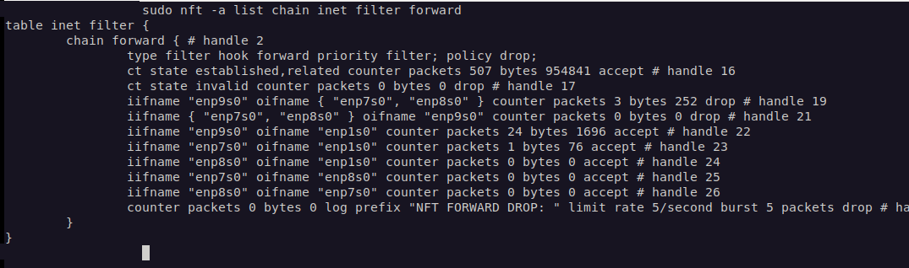

# Cybersecurity Portfolio

**A hands-on cybersecurity and penetration-testing portfolio focused on Linux security, network segmentation, and evidence-based testing.**

I am documenting practical work from my cybersecurity and penetration-testing studies in a private, virtualized lab. Each case study emphasizes **what was configured, why it mattered, how it was verified, and what remains untested**—rather than treating a scanner finding or a successful ping as proof on its own.

This public portfolio presents selected, evidence-backed projects. The private working homelab repository is maintained separately.

## Featured projects

| Project | What I built or assessed | Verified outcome |
| --- | --- | --- |
| **[Linux Mint Security Assessment & Hardening](linux-hardening/README.md)** | Assessed and hardened a Linux Mint KVM/libvirt host using Lynis, LinPEAS, chkrootkit, auditd, AIDE, and targeted configuration reviews. | **Lynis 70 → 76/100**, seven loaded audit rules, reduced unnecessary service/privilege exposure, kernel settings surviving reboot; [screenshots](linux-hardening/README.md#selected-verification-evidence). |
| **[Debian RouterVM — Segmented Network Lab](router-vm/README.md)** | Configured routing, DHCP/DNS, NAT, and default-drop nftables policies across three internal virtual networks. | Verified allowed LAN3 gateway/internet connectivity and blocked LAN3 → LAN1 traffic; nftables drop counter changed **0 → 3 packets** for the reproduced test; [screenshots](router-vm/README.md#verification-screenshots). |
| **[RouterVM Firewall Policy Verification](firewall-verification/README.md)** | Defined assignment-aligned traffic expectations; tested TCP paths, DNS, HTTPS, DHCP and source NAT; built a repeatable client checker. | Live checker validation on all three VMs: **14 PASS, four isolation timeouts corroborated by router counters, no FAIL**; seven checker tests pass. Separate NAT/DHCP evidence recorded. |
| **[Network Monitoring](network-monitoring/README.md)** | Packet analysis and detection engineering. | **Planned** — not presented as a completed implementation. |

### Linux host hardening: assessment to verification

The host assessment included service exposure, account privileges, integrity monitoring, audit coverage, and kernel configuration. A later Lynis assessment recorded **76/100** versus the initial **70/100**. The score is a configuration-hardening indicator, **not a percentage of security achieved**.

[Read the full Linux hardening case study →](linux-hardening/README.md)

### RouterVM: tested network boundaries

The current RouterVM forwards permitted traffic toward WAN while isolating LAN3 from the other internal segments. During a controlled post-restart ICMP test, AgentVM sent three requests to Client1; the relevant nftables isolation counter increased from **0 to 3 packets (252 bytes)**. Separate tests confirmed the AgentVM could still reach its gateway and an external IPv4 endpoint.

[Read the RouterVM case study →](router-vm/README.md) · [View the network topology →](diagrams/router-vm-topology.md)

## Lab environment

| Component | Purpose |
| --- | --- |
| **Linux Mint host** | Workstation and hypervisor |
| **KVM/QEMU · libvirt · virt-manager** | Virtual machines and isolated virtual networks |
| **Debian RouterVM** | Routing, nftables filtering, NAT, and dnsmasq DHCP/DNS |
| **Debian client VMs** | Testing routing and segment-to-segment policies |
| **Fedora AgentVM** | Isolated environment for experimenting with coding-agent tools |
| **Tailscale** | Access to authorized school lab resources; access details are not published |

### Tools and techniques used

**Linux and host security:** Lynis, LinPEAS, chkrootkit, auditd, AIDE, systemd, sysctl, Linux permissions and service inspection.

**Networking:** nftables, dnsmasq, NetworkManager, IPv4 routing, NAT, firewall counters, ICMP, traceroute, SSH, and virtual switches/bridges.

**Reporting:** Git, Markdown, Mermaid topology diagrams, sanitized terminal evidence, and explicit recording of test limitations.

## How these projects are documented

Each project aims to cover:

1. **Objective and architecture** — what the system is supposed to do.
2. **Security controls** — configurations chosen and the reasons behind them.
3. **Positive and negative tests** — expected traffic allowed, prohibited traffic blocked.
4. **Evidence** — observed output, screenshots, and rule-counter changes.
5. **Limitations and next steps** — what the tests do *not* establish and where improvements remain.

See the [RouterVM test report](router-vm/agentvm-connectivity-test-2026-10-16.md) and [Linux findings matrix](linux-hardening/findings.md) for more detailed reasoning and verification history.

## Current limitations and upcoming work

- RouterVM's tested ICMP isolation paths do **not** establish that all TCP/UDP flows or stateful edge cases are blocked.
- Linux host hardening is incremental; the Lynis report retains recommendations, several of which require compatibility and threat-model review.
- Representative RouterVM guest connectivity was retested after restarting the virtual machines; broader VM/service persistence testing remains open.
- Network-monitoring and detection work is planned rather than documented as completed.
- Screenshots have been cropped and reviewed for unnecessary information, but publication requires a final privacy review of internal lab addresses and terminal context.

## Responsible and authorized testing

All testing described here was performed on systems I own or have explicit permission to assess. The repository intentionally excludes credentials, private keys, school VPN configuration, device inventories, and other operational secrets. Configuration and outcomes are presented for **learning and defensive engineering**, not as claims about third-party systems.

---

**Start here:** [Linux Hardening](linux-hardening/README.md) · [RouterVM](router-vm/README.md) · [Network Topology](diagrams/router-vm-topology.md)
