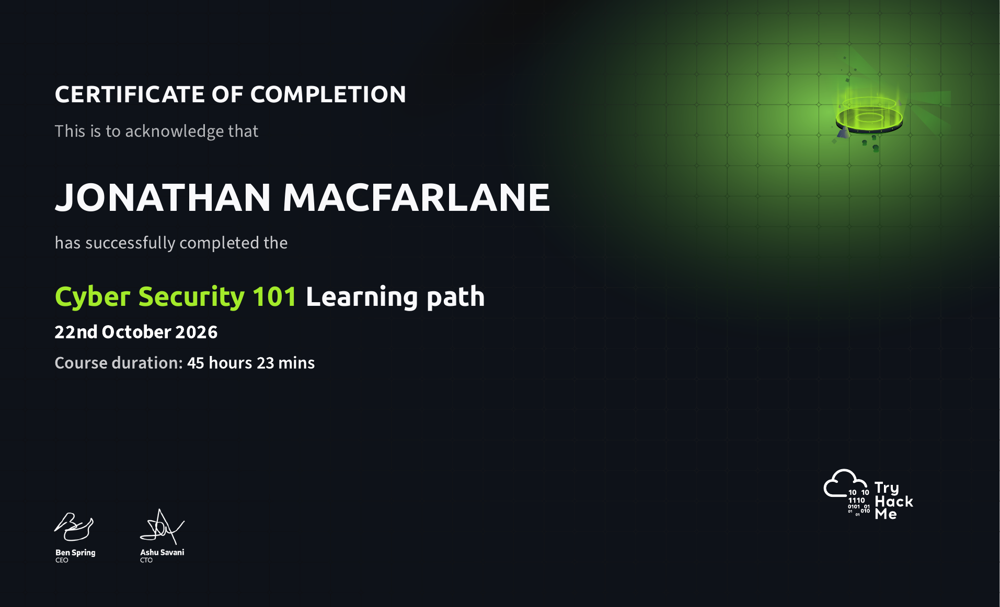

# TryHackMe — Cyber Security 101 (Completed)

**Learning-path certificate of completion · 22 October 2026**

| Detail | Verified result |
| --- | --- |
| Provider | TryHackMe |
| Learning path | Cyber Security 101 |
| Status | **Completed (100%)** |
| Completion date | **22 October 2026** |
| Recorded course duration | **45 hours 23 minutes** |
| Evidence | Official TryHackMe Certificate of Completion supplied by the learner |

**[View my TryHackMe profile](https://tryhackme.com/p/macfarlane.jonathan)**

## What I covered

The learning path introduced a broad set of foundational cybersecurity topics, including networking, operating systems, offensive and defensive security concepts, security monitoring, security tooling, and common web application security risks.

The later modules included hands-on introductions to **SIEM and IDS**, **CyberChef**, **CAPA**, **REMnux**, **FlareVM**, and **OWASP Top 10 (2025)**.

This completion documents structured study and exposure to the topics and tools above. It does **not** mean I hold the separate, exam-based **SEC1 professional certification** or claim professional-level proficiency in every subject.

## How it connects to my portfolio

I am applying these fundamentals in a virtualized KVM/QEMU homelab through Linux host security reviews, segmented Debian networks, nftables policy verification, and evidence-based documentation.

I have started **[TryHackMe Jr Penetration Tester](../training/tryhackme-jr-penetration-tester.md)**, with **9% completion verified on 28 October 2026**. Current studies cover penetration-testing foundations and frameworks; network reconnaissance and Nmap remain upcoming in the learning path. The linked progress log distinguishes completed rooms, ongoing work and future topics.

## Certificate evidence

TryHackMe issued my **Cyber Security 101 Learning path — Certificate of Completion** with a completion date of **22 October 2026** and a recorded duration of **45 hours 23 minutes**.

**[View the original completion certificate (PDF)](./THM-DT40H8IJJL.pdf)**

The official certificate PDF and its image preview are both included in this repository. This learning-path completion certificate is separate from the paid SEC1 professional certification.
