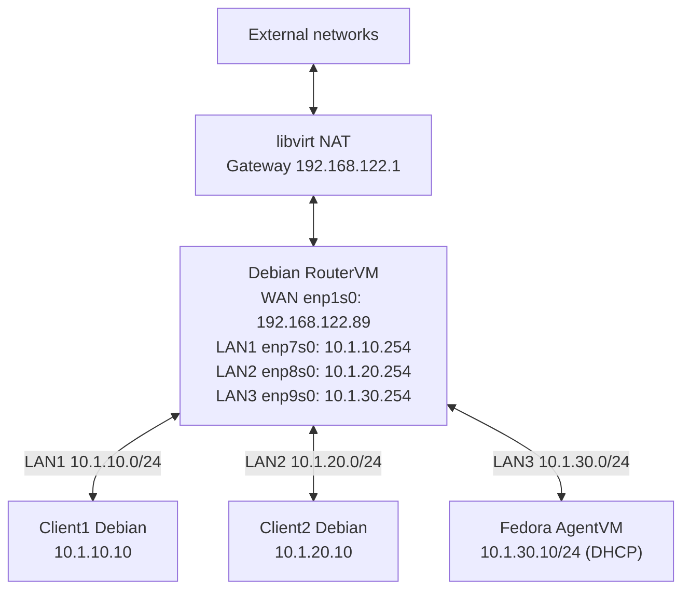

# RouterVM network topology — current layout

This diagram reflects the interfaces and routes reported on 2026-10-16. LAN3 was added for the isolated AgentVM network. The AgentVM's DHCP lease was subsequently verified from its Fedora console: `10.1.30.10/24` with default gateway `10.1.30.254`.

## Current firewall policy (separate from the original coursework exercise)

- All three LANs have explicit permission to forward new traffic to WAN, with IPv4 masquerading for their respective subnets.
- LAN1 ↔ LAN2 forwarding is explicitly **allowed** in the active ruleset.
- LAN3 ↔ LAN1/LAN2 forwarding is explicitly **denied** for new connections.
- Stateful established/related rules precede segment-specific rules.
- Input and forward chains default to drop, with rate-limited logging for unmatched traffic.

See [the active nftables snapshot](../router-vm/configs/active-nftables-snapshot-2026-10-16.md). These are ruleset observations, not proof of newly executed connectivity tests. The original two-LAN assignment used different inter-LAN policy.
