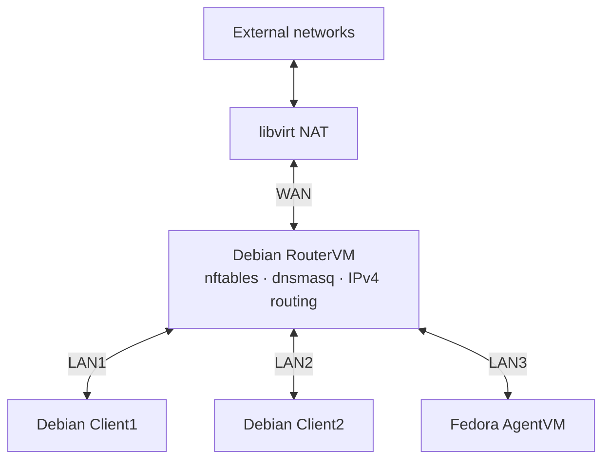

# Debian RouterVM — Historical Linux Mint Network Topology

**Environment:** Linux Mint primary homelab, KVM/QEMU and libvirt

**Router implementation:** Original Debian RouterVM

**Configuration checkpoint:** 16 October 2026

**Status:** Historical, evidence-bounded documentation

## Overview

This diagram illustrates the documented Debian RouterVM network architecture used in the Linux Mint homelab.

The environment includes a WAN connection through libvirt NAT, two coursework LAN segments and an additional LAN3 segment for AgentVM.

This is not the Alpine RouterVM v2 topology or the separate Fedora portable RouterVM fallback.

## Network topology

## Documented forwarding policy

| Traffic path | Documented policy |
| --- | --- |
| LAN1 → WAN | Allowed |
| LAN2 → WAN | Allowed |
| LAN3 → WAN | Allowed |
| LAN1 ↔ LAN2 | Allowed |
| LAN3 → LAN1/LAN2 | Denied for new forwarded connections |
| LAN1/LAN2 → LAN3 | Denied for new forwarded connections |
| Other unmatched forwarding | Default drop |

The documented ruleset includes IPv4 source NAT toward WAN, stateful connection tracking and rate-limited logging.

Established and related connections are accepted before the segment-specific drop rules. As a result, the table describes the intended handling of new forwarded connections, not a guarantee that every pre-existing flow was terminated.

## Verification scope

The historical project documentation includes controlled connectivity tests and corresponding firewall-counter observations.

These observations support conclusions about the specific tested paths, but they do not prove that every possible protocol, destination, traffic state or IPv6 path was examined.

The original school assignment required communication between LAN1 and LAN2. Their allowed forwarding policy is therefore intentional, not a segmentation defect.

LAN3 isolation was introduced as an additional homelab requirement.

## Related evidence

- [Debian RouterVM case study](../router-vm/README.md)
- [Dated nftables configuration snapshot](../router-vm/configs/active-nftables-snapshot-2026-10-16.md)
- [Firewall policy verification](../firewall-verification/README.md)

## Architecture boundaries

This diagram applies only to the historical Debian RouterVM configuration on the Linux Mint host.

The Alpine RouterVM v2 and the Fedora portable fallback have different architectures, deployment states and verification records.

For those environments, see:

- [RouterVM v2 case study](../projects/routervm-v2.md)
- [Fedora portable homelab](../projects/portable-homelab.md)
