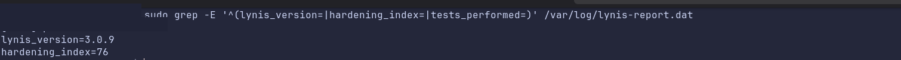
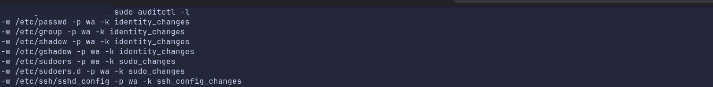

# Linux Mint Host Security Assessment & Hardening

> **Project status:** Assessment and selected remediations completed; evidence curation and some operational checks remain open. All work was conducted on an owned workstation in October 2026.

## At a glance

A practical security review of a **Linux Mint workstation** hosting a KVM/QEMU/libvirt cybersecurity homelab. The goal was to reduce avoidable exposure **without breaking virtualization, access to authorized school labs through Tailscale, or essential desktop workflows**.

| Measure | Before | Latest verified result |
| --- | --- | --- |
| Lynis hardening index | **70/100** | **76/100** (intermediate scan: 75) |
| auditd rules | No monitoring rules | 7 rules verified in earlier checks |
| Unneeded APT cache listener | TCP 3142 on all addresses | Service disabled; listener closed |
| Docker group membership | Elevated Docker-daemon access | Membership removed and access denied without sudo |
| AIDE file-integrity baseline | Not configured | 9,365 entries, clean check recorded |
| Kernel packages | 14 installed images/packages | Reduced to 3 |
| IPv4 source-routing settings | Default and active interface values reported 1 | Global/default and external/virtual interfaces 0 after reboot |
| BPF JIT hardening | 0 | **2**, persisted after reboot |

**What the score means:** Lynis's index measures alignment with its hardening checks; **76/100 does not mean “76% secure.”** The report still contains suggestions, and not all are appropriate for a workstation with virtual networks.

## Environment and constraints

- **Host:** Linux Mint with KVM/QEMU, libvirt, and virt-manager.
- **Lab:** Debian RouterVM, Linux clients, Fedora AgentVM, and additional testing VMs.
- **Remote lab dependency:** Tailscale provides access to authorized school GOAD exercises.
- **Operational considerations:** Some local services and tooling serve legitimate home-lab or file-transfer purposes. Removing them solely to improve a scanner score could reduce functionality.

The host is **not** the same machine as the Debian RouterVM guest. Kernel settings documented here apply to the Mint host unless specified otherwise.

## Approach

1. **Discover:** Run Lynis 3.0.9, LinPEAS, chkrootkit, and targeted manual checks.
2. **Triage:** Distinguish likely vulnerabilities, configuration improvement opportunities, expected lab behavior, and false positives.
3. **Remediate selectively:** Apply small, justified changes with an eye toward operational risk.
4. **Verify:** Inspect settings, counters, service states, and follow-up scans; test a representative VM network path.
5. **Document limits:** Preserve unresolved items and avoid claiming broader verification than the evidence supports.

## Key findings and responses

### 1. Privilege and service exposure
- **Docker group access:** Removed a user from the Docker group, then verified that rootful daemon access without `sudo` was denied. This reduces a route to effectively root-equivalent control.
- **APT caching listener:** An unnecessary service was listening on `0.0.0.0:3142`. It was disabled and the port verified closed.

### 2. Auditing and integrity
- **auditd:** Added seven persistent monitoring rules for identity/privilege and SSH-related configuration; checked the loaded rules and observed an authorized test event.
- **AIDE:** Initialized a file-integrity baseline and recorded a clean check of **9,365 monitored entries**. Frequently changing, large VM images were excluded to keep monitoring practical.
- **Journal:** Integrity verification returned exit status 0.

AIDE checks compare against a baseline; they are **not absolute proof that a machine is uncompromised**. Audit logs provide investigation evidence rather than preventing changes.

### 3. Kernel hardening — October 16

**IPv4 source routing**

The host had `net.ipv4.conf.default.accept_source_route=1` and several interface-specific values of 1. A persistent sysctl file set `all` and `default` to 0, and active interface values were adjusted.

After reboot, `all=0`, `default=0`, and the physical, Tailscale, Docker, and libvirt interfaces checked were 0. Loopback (`lo`) reported 1; with `all=0`, this does not establish effective acceptance of source-routed packets on loopback. No externally exposed interface was found enabled in the verification output.

**BPF JIT hardening**

The host initially reported `net.core.bpf_jit_enable=1` and `net.core.bpf_jit_harden=0`. The setting was changed to **`bpf_jit_harden=2`** and persisted in `/etc/sysctl.d/90-bpf-hardening.conf`. After reboot, it remained at 2 while JIT compilation remained enabled.

**Deliberate exceptions:** IPv4 forwarding remained enabled for the virtualized host environment; loose reverse-path filtering was not changed without assessing the full topology. Disabling kernel-module loading permanently was not pursued because it could disrupt normal workstation operation. These are *contextual decisions*, not blanket security recommendations.

### 4. Scanner alert triage

**chkrootkit:** A BPFDoor-related alert prompted inspection of the associated process and local IPC behavior. Evidence pointed to a Helium AppImage browser broker, making a false positive plausible; no BPFDoor infection was established, but the investigation was not a full malware-forensic certification.

**LinPEAS:** A kernel CVE indication based on version matching was not treated as confirmed exploitability. Distribution patch status and backports require separate verification.

## Verification and results

| Verification | Observed outcome | Important limit |
| --- | --- | --- |
| Lynis reassessment | 70 → 75 → **76** | Scanner index, not a measure of absolute security |
| Source-routing sysctls after reboot | Global/default and relevant physical/virtual interfaces were 0 | Loopback remained 1; no broad packet-level source-route test |
| BPF JIT after reboot | **2** | Does not validate every eBPF workload |
| libvirt after reboot | Service active; seven VM definitions present | The VMs were off at that moment |
| RouterVM and AgentVM pre-reboot | Both started; AgentVM reached gateway and external IPv4 test target (3/3 each) | Not repeated after host reboot |
| School DNS via Tailscale pre-reboot | Internal AD SRV lookup succeeded | Some configured resolver reachability was not exhaustively verified |
| Lynis warnings in filtered output | No `warning[]` entries displayed | Filtered output is not proof of zero vulnerabilities |

The latest score was captured **after** the two sysctl remediations, and reboot checks subsequently confirmed that those settings persisted.

## Residual risks and planned follow-up

- Recheck representative **guest connectivity after host reboot**.
- Reassess remaining Lynis suggestions such as systemd service confinement, file permissions, authentication defaults, and AIDE checksum configuration on their individual merits.
- Preserve Tailscale and other required services while reducing unnecessary permissions or exposure.
- Consider centralized logging as a separate detection-engineering project.
- Review boot security and disk/swap encryption against the workstation's physical threat model.
- Continue collecting selected, carefully redacted evidence for findings not yet illustrated.

The remaining `KRNL-6000` suggestion reflects additional sysctl mismatches with Lynis's profile; it does **not** establish failure of the verified changes.

## Selected verification evidence

These screenshots were captured from the owner's terminal, reviewed, and cropped to omit irrelevant desktop space and account/hostname prompts. They document **specific results at a point in time**, not a guarantee that every security risk is resolved. See [evidence notes](evidence/README.md).

### Final Lynis score

The reassessment recorded a **76/100** hardening index. An index is a scanner configuration metric, not a quantitative security rating.

### Persistent kernel settings

Following a reboot, the host retained `net.core.bpf_jit_harden=2`, with IPv4 source-routing acceptance disabled in the global/default settings. The host still had IPv4 forwarding enabled for its virtual networking use case.

### Loaded audit rules

`auditctl -l` displayed **seven monitoring rules** for identity, privilege, and SSH configuration paths. These rules help detect specified changes; they do not prevent changes.

## Skills demonstrated

Linux security assessment · Exposure reduction · Privilege review · auditd · AIDE · sysctl hardening · False-positive triage · KVM/libvirt compatibility testing · Evidence-based reporting

## Supporting documentation

- [Full findings and historical verification notes](findings.md)
- [Revalidation commands and checklist](verification.md)

## Publication and ethics

The repository contains **sanitized descriptions**, not original unrestricted log dumps. Raw tool logs, keys, private host information, school-specific VPN/DNS configuration, and internal device inventories should remain private. Only systems owned or explicitly authorized for assessment were tested.
