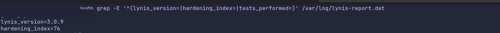
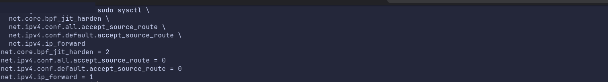
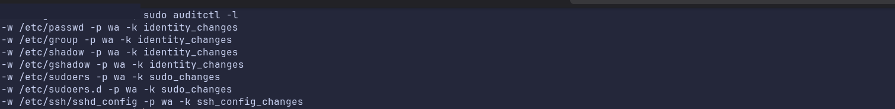

# Linux Mint Host Security Assessment & Hardening

**Project type:** Personal cybersecurity homelab / Defensive security engineering  
**Environment:** Linux Mint 22.3, KVM/QEMU, libvirt, virt-manager  
**Technologies:** Lynis, LinPEAS, chkrootkit, auditd, AIDE, systemd, sysctl  
**Evidence checkpoint:** October 2026  
**Status:** Selected remediations completed and verified; broader security validation remains incomplete

## 1. Objective and problem

This project evaluates and improves the security configuration of a Linux Mint workstation used as the primary hypervisor for a cybersecurity homelab.

The objective was to identify avoidable security exposure, investigate scanner findings, implement justified remediations and verify that important changes remained effective.

A central constraint was preserving legitimate workstation functionality, including KVM/libvirt networking and Tailscale connectivity used for authorized school-lab access.

The project focused on practical risk reduction rather than maximizing a scanner score or applying every hardening recommendation indiscriminately.

## 2. Technology and environment

The assessment was performed on a personal Linux Mint workstation hosting virtualized cybersecurity environments.

| Component | Role |
| --- | --- |
| Linux Mint 22.3 | Primary host operating system |
| KVM/QEMU and libvirt | Virtualization and virtual networking |
| Lynis 3.0.9 | Security configuration assessment |
| LinPEAS and chkrootkit | Enumeration and potential security finding discovery |
| auditd | Monitoring selected security-relevant file changes |
| AIDE | File integrity baseline and comparison |
| systemd and sysctl | Service management and kernel configuration |
| Tailscale | Authorized access to school-lab resources |

The Linux Mint workstation is distinct from the Debian RouterVM guest, the Alpine RouterVM v2 implementation and the Fedora portable homelab.

Host-level changes documented here must not be interpreted as guest firewall or guest operating-system hardening.

## 3. Assessment and implementation

### Initial assessment

The review combined automated security assessment tools with targeted manual investigation.

The initial Lynis hardening index was **70/100**.

Findings and suggestions were reviewed according to their technical relevance, potential security impact and compatibility with the host's intended use.

A scanner recommendation was not automatically treated as a confirmed vulnerability or justification for a configuration change.

### Service and privilege exposure

**APT caching service**

An unnecessary APT caching service was listening on TCP port 3142 across available interfaces.

The service was disabled, and a subsequent check confirmed that the listener was no longer present.

**Docker group membership**

Membership in the Docker group provided access to a privileged container-management interface.

The user was removed from the group, and access to the rootful Docker daemon without sudo was subsequently denied.

**Kernel package maintenance**

The number of installed kernel image/package entries was reduced from 14 to three, retaining a smaller set for maintenance and rollback.

These changes reduced unnecessary exposure or maintenance overhead without disabling the host's required virtualization capabilities.

### Audit logging

Seven persistent audit watch rules were configured for security-relevant identity, privilege and SSH configuration paths.

The monitored locations included:

- `/etc/passwd`
- `/etc/group`
- `/etc/shadow`
- `/etc/gshadow`
- `/etc/sudoers`
- `/etc/sudoers.d`
- `/etc/ssh/sshd_config`

The loaded rules were inspected using `auditctl`, and an earlier controlled test produced an audit event.

After the later host reboot, seven loaded rules were again observed.

These rules improve visibility into selected configuration changes. They do not prevent modification or provide complete system monitoring.

### File integrity monitoring

AIDE was initialized with a baseline covering **9,365 monitored entries**.

Frequently changing large virtual-machine images were excluded to keep integrity monitoring practical.

A subsequent check returned a clean result against the recorded baseline.

This demonstrates that the monitored files matched the configured baseline during that check. It does not establish that the entire workstation was free of compromise.

Journal integrity verification also returned exit status 0 during the documented assessment.

### Kernel hardening

Two kernel-related configuration areas were investigated and modified on 16 October 2026.

**IPv4 source routing**

The host initially reported source-routing acceptance enabled in its default configuration and on several interfaces.

A persistent sysctl configuration set:

```ini id="i61frz"
net.ipv4.conf.all.accept_source_route = 0
net.ipv4.conf.default.accept_source_route = 0
```

The existing interfaces were also adjusted during the configuration session.

After reboot, both global/default settings remained zero. The checked physical, Tailscale, Docker and libvirt interfaces also reported zero.

Loopback (`lo`) reported a value of one after reboot. With the global setting at zero, this observation does not independently establish effective acceptance of source-routed packets on loopback. A separate packet-level assessment was not performed.

**BPF JIT hardening**

The host originally reported:

```text id="gxqrue"
net.core.bpf_jit_enable = 1
net.core.bpf_jit_harden = 0
```

The hardening setting was changed to:

```text id="uakx16"
net.core.bpf_jit_harden = 2
```

The value was persisted through `/etc/sysctl.d/90-bpf-hardening.conf`.

Following a host reboot, the recorded value remained two, while BPF JIT compilation remained enabled.

### Deliberate configuration exceptions

Some hardening recommendations were not applied because of functional or compatibility considerations.

- IPv4 forwarding remained enabled for the virtualization environment.
- Reverse-path filtering was not changed without further topology analysis.
- Permanent kernel-module loading restrictions were not applied.
- Tailscale connectivity and required virtualization services were preserved.
- Other Lynis suggestions were retained for individual risk assessment.

These decisions reflect the documented workstation requirements, not universal hardening recommendations.

## 4. Security finding interpretation

### chkrootkit alert

A BPFDoor-related indication prompted an investigation of the associated process and local communication behavior.

The available evidence pointed toward a Helium AppImage browser broker, making a false positive plausible.

No BPFDoor infection was established by the investigation. However, the recorded work does not constitute a comprehensive malware-forensic examination or proof that the system was uncompromised.

### LinPEAS kernel finding

LinPEAS reported a potential kernel CVE based on version information.

The finding was not treated as confirmed exploitability because distribution patches, backports and actual vulnerability conditions require additional verification.

### Lynis suggestions

The follow-up Lynis reports retained configuration suggestions, including kernel settings, service confinement, authentication configuration and file permissions.

These represent potential areas for review rather than automatically confirmed vulnerabilities.

## 5. Testing and verification

The work included configuration inspection, service checks, follow-up scanner runs and selected functional regression tests.

| Verification | Observed result | Limitation |
| --- | --- | --- |
| Lynis baseline | 70/100 | Configuration assessment metric |
| Lynis follow-up | 75/100, then 76/100 | Does not quantify overall security |
| auditd | Seven loaded rules | Monitoring limited to configured paths |
| AIDE | Clean check against 9,365-entry baseline | Excluded files are not covered |
| APT caching | TCP/3142 listener no longer present | Historical service-state observation |
| Docker privileges | Rootful daemon access denied without sudo | Historical access check |
| IPv4 source routing | Global/default and selected interfaces at zero after reboot | Loopback exception; no broad packet-level test |
| BPF JIT | Hardening value two after reboot | Does not validate every eBPF workload |
| libvirt | Service active; seven VM definitions registered after reboot | Guest connectivity not tested after that reboot |
| RouterVM and AgentVM | Guest gateway and external IPv4 connectivity passed before reboot | Does not establish post-reboot guest connectivity |
| Tailscale | Local device reported connected after reboot | Full school application access not verified |

### Lynis reassessment

The final recorded Lynis hardening index was **76/100**, following an intermediate score of 75 and the initial baseline of 70.

The improvement is a measurable change in the tool's configuration-hardening index.

It is not equivalent to a 76% security rating, elimination of all vulnerabilities or independent proof of effective protection against attacks.

### Functional compatibility testing

Before the host reboot, RouterVM and AgentVM were started, and AgentVM successfully reached its gateway and an external IPv4 test endpoint.

These tests supported continued functionality of the selected VM network path after the hardening changes.

Following the host reboot, libvirt was active and seven VM definitions remained registered, but the VMs were stopped during the recorded inspection.

The available evidence therefore does not establish complete post-reboot guest connectivity or full Tailscale-dependent school-lab access.

### Selected evidence

**Final Lynis reassessment**



The screenshot records Lynis 3.0.9 and the final hardening index.

**Post-reboot kernel configuration**



The screenshot documents the persistent BPF JIT hardening value and the checked IPv4 source-routing settings.

**Loaded audit rules**



The screenshot documents seven monitoring rules loaded in the inspected session.

These images represent specific historical observations, not a comprehensive assessment of current system security.

[Evidence notes](evidence/README.md)

## 6. Results and limitations

### Verified results

The documented October 2026 work demonstrates:

- A Lynis hardening index improvement from 70 to 76.
- Removal of unnecessary privileged Docker group access.
- Removal of an unneeded TCP/3142 listener.
- Seven configured and loaded audit monitoring rules.
- An AIDE baseline and clean integrity check.
- Reduced installed kernel package overhead.
- Persistent BPF JIT hardening across a host reboot.
- Persistent global/default IPv4 source-routing restrictions.
- Selected virtualization compatibility checks.

### Limitations

The assessment does not establish:

- Comprehensive protection against compromise.
- Absence of malware or exploitable vulnerabilities.
- Complete audit coverage or continuous integrity monitoring.
- Full post-reboot guest networking functionality.
- Complete school-lab connectivity after the host reboot.
- Current configuration status following later system changes.
- Verification of full-disk or swap encryption.
- Resolution of every remaining Lynis suggestion.

The detailed findings were collected during multiple October 2026 sessions. Some earlier checkpoints identify tests as pending that were subsequently completed.

The latest applicable observation must be used when interpreting each control.

The full original scanner logs are not included in the public repository, so the published evidence is a curated record rather than an independently reproducible archive of every finding.

## 7. Lessons learned

**Scanner findings require context.** Automated tools identify potential weaknesses and configuration opportunities, but their output must be interpreted against the actual environment and threat model.

**Hardening must preserve required functionality.** Network forwarding, virtual-machine services and authorized remote-lab access are legitimate operational requirements, not necessarily misconfigurations.

**Configuration and verification are separate activities.** Writing a persistent sysctl file does not establish that its setting survives reboot until the resulting state is checked.

**Security controls have different purposes.** auditd provides selected event visibility, AIDE detects changes relative to a baseline, and kernel or service hardening changes system behavior.

**A higher scanner score is not the final objective.** Measurable risk reduction, predictable operation and defensible evidence are more meaningful than applying every recommendation.

## 8. Supporting documentation

- [Detailed findings and verification history](findings.md)
- [Revalidation checklist](verification.md)
- [Evidence screenshot notes](evidence/README.md)
- [Primary portfolio overview](../README.md)

The detailed findings file retains chronological observations, including superseded intermediate checkpoints. This case study summarizes their latest documented status.

## 9. Remaining work

Future verification should focus on:

- Rechecking current Mint configuration and service exposure.
- Collecting updated Lynis, auditd and AIDE evidence.
- Revalidating representative guest connectivity after a relevant host reboot.
- Reviewing outstanding hardening suggestions against operational requirements.
- Evaluating host encryption and physical-access risks separately.
- Recording any changes since the October 2026 assessment.

These activities remain outstanding and are not presented as completed achievements.

## Publication and authorization

The assessment was performed on a personally owned workstation.

Published evidence consists of selected, sanitized observations. Raw system logs, private identifiers, school-lab access details and credentials are not included in this case study.

The documented results apply to their original configurations and verification dates.
