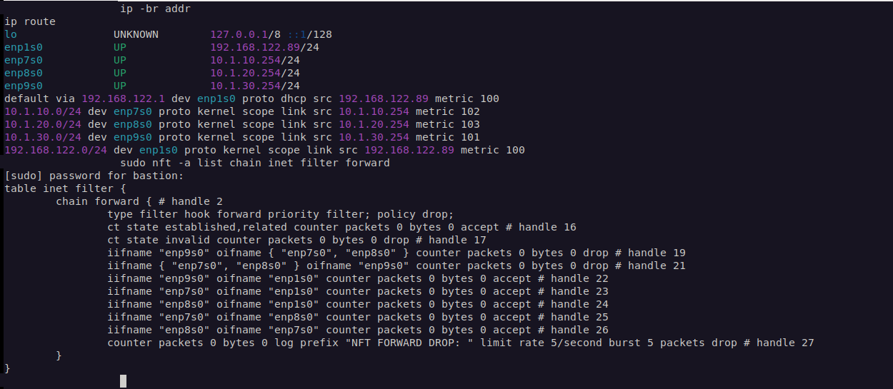
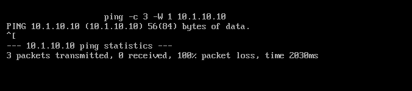
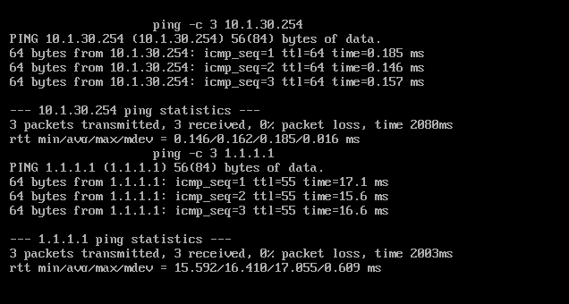

# Debian RouterVM — Segmented Network Lab

## Overview
A Debian-based router built with **KVM/QEMU and virt-manager** as part of a controlled cybersecurity networking lab. It was built for a school exercise requiring routing between LAN1 and LAN2, and was subsequently expanded with an isolated third subnet for AgentVM. It connects to a libvirt NAT uplink, assigns client addresses using **dnsmasq**, and uses **nftables** for filtering and NAT.

**Status (verification through 2026-10-19):** The three-LAN lab has dated ICMP evidence plus later TCP/22 policy checks, UDP/TCP DNS, IPv4 HTTPS, source-NAT and DHCP evidence. LAN1 ↔ LAN2 TCP/22 succeeded in both directions; four LAN3 isolation probes timed out with corroborating grouped RouterVM drop counters. See the [firewall policy verification project](../firewall-verification/README.md). These are point-in-time results for selected paths; broader protocol, stateful edge-case and reboot-persistence testing remain open.

## Configuration history

The **school assignment required LAN1 ↔ LAN2 forwarding to be allowed**. An earlier configuration/test run instead denied it; that observation was a deviation from the assignment requirement, not successful verification of the intended policy. On 2026-10-16, the active configuration had an additional LAN3 for AgentVM, while explicitly allowing LAN1 ↔ LAN2 and isolating LAN3 from LAN1/LAN2. The older tests document historical behavior, not assignment compliance.

## Learning objectives
- Configure a Linux router with one WAN and, after expansion, three LAN interfaces and persistent IPv4 forwarding.
- Provide DHCP/DNS to two separate internal networks.
- Apply a default-deny policy to router input and routed traffic.
- Allow client internet access using source NAT with segment-specific inter-LAN policies.
- Verify both successful and intentionally blocked flows.

## Network architecture

See [the Mermaid topology](../diagrams/router-vm-topology.md) for a diagram that renders on GitHub.

| Segment | Subnet | Router interface | Router address | Role |
| --- | --- | --- | --- | --- |
| WAN (libvirt default NAT) | `192.168.122.0/24` | `enp1s0` | DHCP lease (observed `192.168.122.89`) | Upstream connectivity |
| LAN1 | `10.1.10.0/24` | `enp7s0` | `10.1.10.254` | Internal client network |
| LAN2 | `10.1.20.0/24` | `enp8s0` | `10.1.20.254` | Internal client network |
| LAN3 | `10.1.30.0/24` | `enp9s0` | `10.1.30.254` | AgentVM network |

The upstream gateway was `192.168.122.1` in the tested environment. Example client DHCP reservations were `10.1.10.10` on LAN1 and `10.1.20.10` on LAN2. These addresses describe a private, virtual-only lab topology; they are not externally reachable public endpoints.

## Components
- **Router:** Debian (Trixie), NetworkManager profiles for the four interfaces
- **Addressing/DNS:** dnsmasq with independent DHCP ranges and static leases
- **Routing:** `net.ipv4.ip_forward=1`; default route via the upstream libvirt NAT gateway
- **Firewall/NAT:** nftables using `inet filter` and `ip nat` tables
- **Clients:** two minimal Debian VMs, one on each internal segment

## Firewall design

The router's **input** and **forward** chains use a **drop** policy. Rules accept loopback and established/related connections, reject invalid traffic, and selectively allow required services:

- DHCP (`udp/67`) and DNS (`udp,tcp/53`) from all three internal interfaces to the router.
- SSH (`tcp/22`) from the specified upstream virtual subnet to the router, for administration inside the trusted host lab.
- ICMP and IPv6 ICMP as configured in the tested ruleset.
- New forwarding from LAN1, LAN2, or LAN3 to WAN; return packets are allowed by connection tracking.
- **School assignment:** LAN1 ↔ LAN2 forwarding required. **Active policy on 2026-10-16:** LAN1 ↔ LAN2 explicitly allowed; new LAN3 ↔ LAN1/LAN2 forwarding explicitly denied. See [current firewall snapshot](configs/active-nftables-snapshot-2026-10-16.md).
- Masquerade internal IPv4 source addresses when leaving through WAN.

**Security boundary:** The libvirt default network also provides an upstream NAT layer. The lab's LAN separation is enforced by the RouterVM's forwarding policy, not merely by assigning different subnets.

## DHCP and DNS
### Historical two-LAN configuration

In the original exercise, dnsmasq served:
- **LAN1:** `10.1.10.10–10.1.10.100`
- **LAN2:** `10.1.20.10–10.1.20.100`

Client default gateways were `10.1.10.254` and `10.1.20.254` respectively. The dnsmasq syntax check returned **OK**, and the service was confirmed active after restart.

### Later documented configuration — 2026-10-19

The [firewall verification record](../firewall-verification/README.md#network) documents dynamic pools of `.100–.200` on each LAN with 12-hour leases. Client1 and Client2 have reserved `.10` addresses with infinite leases; AgentVM has reserved `10.1.30.10` with a 12-hour lease and gateway `10.1.30.254`. Server-side DHCP evidence records DISCOVER/OFFER/REQUEST/ACK for Client1/Client2 and REQUEST/ACK for AgentVM; no forced renewals were performed. The older ranges above are retained as configuration history.

## Historical test results (including an assignment-policy deviation)

| Test | Expected | Observed during lab |
| --- | --- | --- |
| Router reaches upstream gateway | Success | Passed |
| Router reaches external IPv4 destination | Success | Passed |
| Client1 reaches external IPv4 destination | Success through router/NAT | Passed |
| Client2 reaches external IPv4 destination | Success through router/NAT | Passed |
| Client1 ↔ Client2 routed traffic | **Allowed (assignment requirement)** | **Blocked in the earlier configuration — did not meet requirement** |
| DNS and DHCP service | Respond on each LAN | Configured and tested |
| Firewall drop logging | Evidence of rejected traffic | Drop entries observed after test traffic |

Later verification on 2026-10-19 confirmed fresh TCP/22 connectivity between LAN1 and LAN2 in both directions, with nftables accept counters, as documented in the [firewall policy verification project](../firewall-verification/README.md) in the public portfolio. That project also documents DNS, DHCP, IPv4 HTTPS and source-NAT tests. These later checks do not establish coverage of every protocol or policy edge case.

Traceroute from clients showed the RouterVM as the first hop and the libvirt NAT gateway as the next hop. These results were recorded during the original exercise; **raw terminal transcripts and screenshots have not yet been uploaded here**.

## Current routing snapshot (2026-10-16)

- WAN: `192.168.122.89/24`, default gateway `192.168.122.1` on `enp1s0`.
- LAN1: `10.1.10.254/24`, connected route via `enp7s0`.
- LAN2: `10.1.20.254/24`, connected route via `enp8s0`.
- LAN3: `10.1.30.254/24`, connected route via `enp9s0`.

These values are based on `ip -br addr` and `ip route` output from RouterVM. The existence of a route does not itself establish client reachability or successful isolation tests.

## Historical three-LAN ICMP validation — 2026-10-16

The current policy **meets the assignment requirement** to allow LAN1 ↔ LAN2 and adds LAN3 isolation from LAN1/LAN2. The following controlled tests were conducted in the active topology.

| Test | Observed result | Evidence scope |
| --- | --- | --- |
| AgentVM → RouterVM LAN3 gateway | 3/3 ICMP replies | Local gateway connectivity |
| AgentVM → external IPv4 destination | 3/3 ICMP replies | Outbound routing/NAT path operational |
| AgentVM → Client1 (LAN1) | 0/3 ICMP replies | Matching firewall drop counter increased |
| AgentVM → Client2 (LAN2) | 0/3 ICMP replies | Matching firewall drop counter increased |
| Client1 (LAN1) → AgentVM | 0/3 ICMP replies | Reverse-direction drop counter increased |

During the two AgentVM-to-client tests, the LAN3 → LAN1/LAN2 nftables drop counter rose from **0 to 6 packets / 504 bytes**. In the reverse-direction Client1 → AgentVM test, its corresponding drop counter rose from **0 to 3 packets / 252 bytes**. These counter changes provide evidence that **the firewall handled the tested denied packets**, rather than relying on ping timeouts alone.

**Boundaries:** These results demonstrate only the tested ICMP paths. Client2 → AgentVM was not separately tested, nor were all TCP/UDP services or stateful edge cases. See the [detailed connectivity and counter report](agentvm-connectivity-test-2026-10-16.md).

## Verification screenshots

The following screenshots were captured during the post-restart RouterVM/AgentVM tests. They are point-in-time evidence of **specific configurations and ICMP traffic flows**; they do not prove every path or protocol is secure. See [evidence provenance and publication notes](evidence/README.md).

### Network routes and forwarding policy

The four active interfaces and the expected routes establish the tested network layout. The forward chain uses a default-drop policy, with explicit rules for LAN3 isolation and permitted WAN-bound traffic. Initial displayed rule counters were zero.

### Attempted LAN3-to-LAN1 connection

AgentVM sent three ICMP echo requests toward Client1 and received no replies. Failure alone would not prove that the firewall caused it, so the drop rule was checked separately.

### Firewall enforcement confirmed

The relevant LAN3 → LAN1/LAN2 drop rule increased from **0 to 3 packets / 252 bytes**, matching the three attempted probes. This provides direct evidence of rule enforcement for the tested ICMP flow.

### Allowed gateway and outbound connectivity

AgentVM received **3/3 replies** from its LAN3 gateway and **3/3 replies** from an external IPv4 endpoint, showing that the tested isolation policy did not block those intended routes.

**Publication caution:** These images retain virtual lab addresses and may include local terminal context. Review before making the repository public; no evidence of school VPN inventory is included.

## Operational and security considerations
- An input-chain drop policy protects the **router itself**; a forward-chain drop policy separately controls **transit traffic**.
- Explicit established/related matching permits reply packets without broadly opening forwarding.
- Broad SSH access from the upstream virtual subnet is convenient for this controlled exercise, but would need tighter source restrictions and key-based hardening in a less trusted environment.
- DHCP reservations improve consistency but do not replace network access controls.
- IPv6 handling and logging policy should be reviewed whenever extending the lab or exposing additional interfaces.

## Evidence to add
- [ ] Sanitized `nft list ruleset` excerpts and explanations
- [ ] Sanitized `nmcli` profiles and route summary
- [ ] dnsmasq configuration excerpts (no sensitive lease identifiers)
- [x] Documented successful outbound connectivity and blocked inter-LAN ICMP (text-based verification)
- [x] Cropped screenshots of the tested paths committed to the private repository
- [x] Documented forward-chain drop counter deltas for LAN3 isolation
- [ ] Optional sanitized screenshots of nftables drop log events
- [ ] Reboot persistence verification

## Lessons learned
A working routed connection is not proof of effective segmentation. **Positive tests** (allowed traffic works) and **negative tests** (prohibited traffic fails) are both necessary. This lab also highlights why NAT, firewall input policy, and firewall forwarding policy are distinct controls.

## Ethical scope
This project describes testing on owned or explicitly authorized virtual systems. Do not reuse these lab subnets as a claim about third-party infrastructure; never commit credentials, school VPN information, private access tokens, or unsanitized captures.
