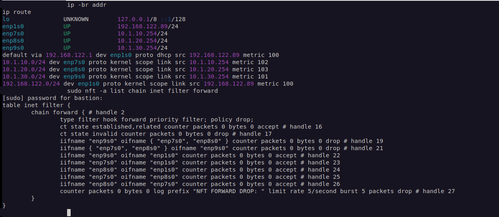
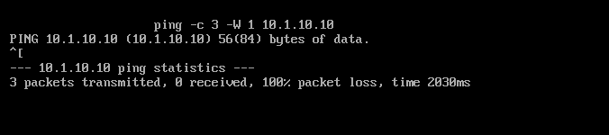
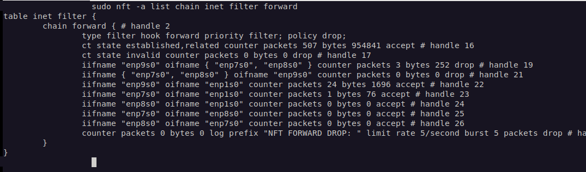
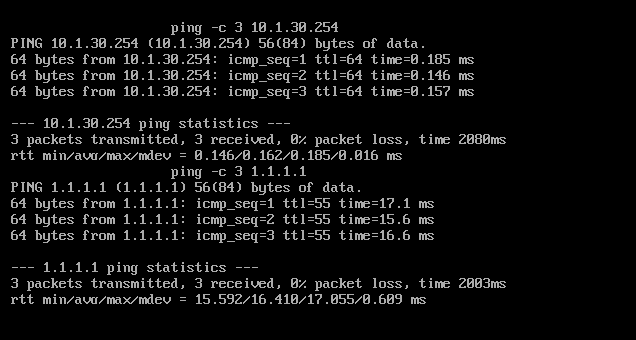

# Debian RouterVM — Segmented Network Lab

**Project type:** Educational networking and personal homelab extension  
**Environment:** Linux Mint primary homelab, Debian RouterVM, KVM/QEMU, libvirt  
**Technologies:** nftables, dnsmasq, IPv4 routing, NAT, DHCP, DNS, Linux networking  
**Evidence checkpoints:** 16 and 19 October 2026  
**Status:** Selected routing and firewall behavior verified; broader validation incomplete

## 1. Objective and context

This project involved building a Linux-based router for a virtualized cybersecurity networking lab.

The original school assignment required two internal networks with working client addressing, routing, DNS resolution and internet connectivity. Communication between LAN1 and LAN2 was also required.

I subsequently extended the environment with a third network, LAN3, for an AgentVM. This introduced an additional requirement: prevent new forwarded connections between LAN3 and the two coursework networks while preserving authorized LAN1/LAN2 communication and outbound connectivity.

The objective was to implement the routing and security policies, then verify their behavior using controlled traffic and router-side evidence.

## 2. Technical environment

The RouterVM was a Debian guest running on the primary Linux Mint KVM/libvirt hypervisor.

| Component | Purpose |
| --- | --- |
| Linux Mint host | Primary virtualization environment |
| Debian RouterVM | Routing, firewall and network services |
| libvirt NAT network | Upstream WAN connection |
| LAN1 | First coursework client network |
| LAN2 | Second coursework client network |
| LAN3 | Additional AgentVM network |
| dnsmasq | Internal DHCP and DNS |
| nftables | Packet filtering and source NAT |

The three LAN networks use separate virtual interfaces and IPv4 subnets.

[View the historical network topology](../diagrams/router-vm-topology.md)

This implementation is separate from the Alpine RouterVM v2 project and the Debian routing fallback used later on the Fedora portable homelab.

## 3. Design and implementation

### Routing architecture

The RouterVM connects its internal networks to an upstream libvirt NAT network.

IPv4 forwarding allows the router to pass permitted traffic between interfaces. Source NAT translates internal client addresses to the RouterVM's WAN address for outbound connections.

The upstream libvirt network provides a further NAT layer. This does not replace the RouterVM's own firewall or segmentation requirements.

### DHCP and DNS

dnsmasq was configured to provide client addressing and DNS services on the internal networks.

The documented configuration uses separate DHCP pools and reservations for the relevant guests.

During the October 19 verification:

- Client1 and Client2 had recorded DHCP DISCOVER/OFFER/REQUEST/ACK exchanges.
- AgentVM had recorded DHCP REQUEST/ACK exchanges.
- All three guests successfully queried their corresponding RouterVM DNS addresses over UDP and TCP.

The AgentVM journal entries did not include a complete discovery exchange in the supplied evidence. No forced DHCP renewal was performed.

[Detailed DHCP and DNS observations](../firewall-verification/evidence-2026-10-19.md)

### nftables firewall

The RouterVM uses separate `input` and `forward` chains with default-drop policies.

The input chain controls traffic addressed to the router itself. The forward chain controls traffic routed between networks.

The documented rules include:

- Established/related connection acceptance.
- Invalid-packet rejection.
- DHCP and DNS access on the internal interfaces.
- SSH administration from the specified upstream virtual subnet.
- Permitted forwarding from the LANs toward WAN.
- Permitted forwarding between LAN1 and LAN2.
- Denial of new forwarding between LAN3 and LAN1/LAN2.
- Source NAT for the internal IPv4 networks.
- Rate-limited logging for selected unmatched traffic.

### Intended forwarding behavior

| Traffic path | Intended policy |
| --- | --- |
| LAN1 → LAN2 | Allow |
| LAN2 → LAN1 | Allow |
| LAN1 → WAN | Allow |
| LAN2 → WAN | Allow |
| LAN3 → WAN | Allow |
| LAN3 → LAN1/LAN2 | Deny new connections |
| LAN1/LAN2 → LAN3 | Deny new connections |
| Unmatched forwarding | Default drop |

Stateful established/related acceptance precedes the segment-specific drop rules. This means that the new-connection policy does not necessarily terminate connections already tracked before a configuration change.

[Reviewed October 16 nftables snapshot](configs/active-nftables-snapshot-2026-10-16.md)

## 4. Configuration history and requirements

The implementation changed during the project.

### Original coursework configuration

An earlier two-LAN configuration allowed outbound connectivity but blocked LAN1/LAN2 communication.

Although the blocking behavior was observed during testing, it did not satisfy the assignment requirement to permit communication between the two coursework networks.

This is a documented requirements mismatch, not a successful security-control outcome.

The [historical two-LAN nftables example](configs/nftables-example.md) represents that earlier configuration. It is a reconstructed teaching example, not the final running ruleset or a recommended assignment-compliant template.

### Three-LAN configuration — October 16

The later reviewed configuration included LAN3 and explicitly allowed LAN1/LAN2 communication.

LAN3 was isolated from the coursework LANs for new forwarded connections.

The October 16 work included controlled ICMP tests and firewall-counter observations.

### Expanded verification — October 19

The later firewall verification project tested additional traffic paths, including bidirectional TCP/22, DNS, IPv4 HTTPS, NAT and DHCP.

A subsequent logging change was tested separately.

These stages are documented independently so observations from one configuration are not incorrectly attributed to another.

## 5. Testing and verification

### October 16 — ICMP and firewall counters

The recorded tests included successful permitted traffic and intentionally prohibited traffic.

| Source | Destination | Observed result |
| --- | --- | --- |
| AgentVM | RouterVM LAN3 gateway | 3/3 ICMP replies |
| AgentVM | External IPv4 endpoint | 3/3 ICMP replies |
| AgentVM | Client1 | 0/3 ICMP replies |
| AgentVM | Client2 | 0/3 ICMP replies |
| Client1 | AgentVM | 0/3 ICMP replies |

A timeout or missing ICMP reply does not independently prove that the router blocked the packet.

The RouterVM counters supplied additional evidence:

- LAN3 → LAN1/LAN2 drop counter increased by six packets and 504 bytes during the initial AgentVM-to-client probes.
- LAN1/LAN2 → LAN3 drop counter increased by three packets and 252 bytes during the Client1-to-AgentVM test.

The results support firewall enforcement for those tested ICMP paths.

A separate post-VM-restart test observed AgentVM sending three ICMP requests toward Client1, receiving no replies, and the matching RouterVM drop counter increasing from zero to three packets.

This was a selected VM-restart validation, not a comprehensive host-reboot persistence test.

[Detailed October 16 connectivity report](agentvm-connectivity-test-2026-10-16.md)

### October 19 — Expanded policy verification

The later [firewall verification project](../firewall-verification/README.md) recorded a larger controlled test set.

| Area | Recorded result | Evidence boundary |
| --- | --- | --- |
| LAN1 ↔ LAN2 | Fresh TCP/22 connections succeeded in both directions | Selected TCP paths |
| LAN3 ↔ LAN1/LAN2 | Four prohibited TCP/22 probes timed out | Corroborated with router counters |
| UDP/TCP DNS | Successful router DNS queries from all three guests | Selected hostname and resolver endpoints |
| IPv4 HTTPS | HTTP/2 200 returned for all three guests | Selected external service |
| Source NAT | Three matching LAN-ingress/WAN-egress TCP SYN pairs | Translation at RouterVM |
| DHCP | Recorded lease exchanges and server journal entries | No forced renewal test |
| Services | nftables and dnsmasq enabled and active | No new reboot test |

The automated checker recorded **14 PASS**, **four NEEDS_ROUTER_EVIDENCE**, and **zero FAIL**.

The four prohibited connections were not automatically classified as verified firewall drops. Separate RouterVM counter changes corroborated blocking during the test interval.

[Live checker evidence](../firewall-verification/live-checker-validation-2026-10-19.md)

### October 19 — Denial logging retest

A later change added rate-limited logging rules immediately before the unconditional LAN3 isolation drops.

The checker was run again after the firewall reload.

Kernel journal entries identified all four prohibited TCP/22 source/destination paths, with matching directional drop-counter totals.

The log entries provided more precise attribution than the earlier grouped counters alone.

Logging-rate behavior under sustained traffic was not tested, and the configuration does not guarantee that every dropped packet will be logged.

[Logging retest](../firewall-verification/logging-validation-2026-10-19.md)

## 6. Selected verification evidence

The following screenshots document a controlled post-restart test on 16 October 2026.

### Router interfaces and forwarding rules

The screenshot records the relevant virtual interfaces, routes and firewall rules before the test traffic.

### Prohibited ICMP connection

AgentVM sent three ICMP echo requests toward Client1 and received no replies.

### Matching firewall drop counter

The matching LAN3 isolation drop counter increased from zero to **three packets and 252 bytes** during the controlled test.

### Permitted gateway and external connectivity

AgentVM successfully reached its own gateway and an external IPv4 endpoint, with three replies from each.

These screenshots support the specific recorded observations. They do not establish comprehensive security across all possible traffic paths.

[Evidence provenance and publication notes](evidence/README.md)

## 7. Security considerations and limitations

### Security considerations

The RouterVM separates several security functions:

- The input policy protects access to the router itself.
- The forwarding policy governs transit between networks.
- Connection tracking permits return traffic for established sessions.
- Source NAT allows internal clients to communicate through the upstream network.
- DHCP reservations provide predictable addressing but are not access controls.

The documented SSH allowance from the upstream virtual subnet was suitable for the controlled lab arrangement. It should not be treated as a recommended unrestricted management policy for less trusted networks.

### Verified outcomes

The October 2026 evidence supports:

- Selected permitted traffic between LAN1 and LAN2.
- Selected prohibited LAN3 traffic blocked at RouterVM.
- Working DNS and observed DHCP service behavior.
- Successful outbound IPv4 connectivity.
- RouterVM source NAT for tested connections.
- Path-specific denial logging after the October 19 configuration change.
- Selected virtual-machine restart functionality.

### Unverified or incomplete areas

The project does not establish:

- Correct behavior for every TCP/UDP port or protocol.
- IPv6 isolation or forwarding behavior.
- Protection against address spoofing.
- How all established sessions behave following policy changes.
- Comprehensive validation of router management access.
- Complete logging coverage or high-rate logging behavior.
- Full persistence across a new host reboot.
- Current operational state after later configuration changes.

The findings are based on the original user-run test observations and published supporting records, not an independent third-party security assessment.

## 8. Lessons learned

**Security requirements must be verified before evaluating the outcome.** The initial LAN1/LAN2 isolation behavior did not meet the actual assignment requirements, despite producing observable dropped traffic.

**Positive and negative tests serve different purposes.** Successful connections confirm intended functionality, while negative tests investigate restricted paths.

**A failed connection is not sufficient proof of firewall enforcement.** Router-side counters and path-specific logs provide stronger evidence of where packets were handled.

**Configuration history matters.** Results from different dates and rulesets should not be combined as though the system remained unchanged.

**Network controls are layered.** Routing, NAT, router input filtering, forwarding policy and guest host firewalls have distinct roles and need separate verification.

## 9. Supporting documentation and next steps

### Documentation

- [Historical network topology](../diagrams/router-vm-topology.md)
- [October 16 nftables snapshot](configs/active-nftables-snapshot-2026-10-16.md)
- [October 16 connectivity and counter tests](agentvm-connectivity-test-2026-10-16.md)
- [RouterVM verification checklist](verification.md)
- [Expanded firewall verification case study](../firewall-verification/README.md)

### Future validation

Additional work could include:

- Controlled tests of more TCP and UDP services.
- Dedicated IPv6 policy review.
- Stateful connection behavior across firewall changes.
- Router management access testing.
- Full guest and service persistence verification after a relevant reboot.

These are outstanding validation opportunities rather than completed achievements.

## Authorization and publication

The documented tests were performed within an owned or authorized virtual lab.

Published records contain selected internal lab addressing and sanitized technical observations. They must not be interpreted as information about third-party networks.

Credentials, private keys, school VPN configuration and unreviewed operational logs are outside the intended publication scope.
